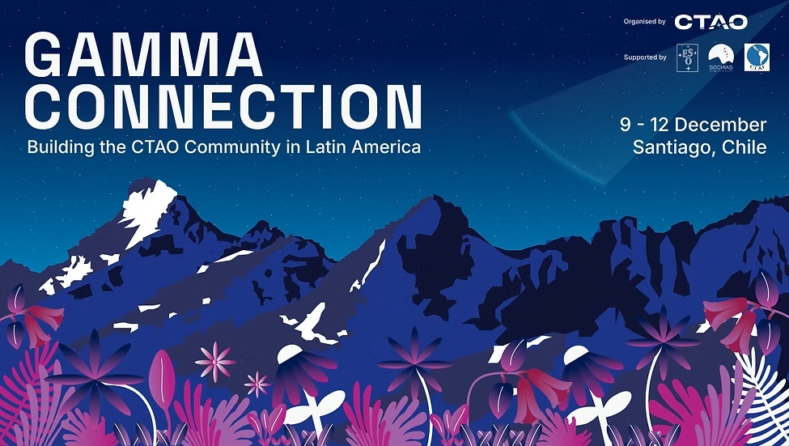

# Gamma Connection, Santiago de Chile, 2026

**Disclaimer** : still under construction!

Locations: ESO offices, Alonso de Córdova 3107, Santiago de Chile ([OpenStreeMap](https://www.openstreetmap.org/search?query=Alonso+de+C%C3%B3rdova+3107%2C+Santiago+de+Chile&zoom=19&minlon=2.3313519358634953&minlat=48.83244823194712&maxlon=2.336324751377106&maxlat=48.83413435118975#map=19/-33.399494/-70.600078&layers=N))

The indico page of the workshop is [https://indico.cta-observatory.org/event/7332/](https://indico.cta-observatory.org/event/7332/).

## Table of contents

1. [Overview](#scope)
2. [Gammapy hands-on sessions (9h00-17h00)](#hands-on)
3. [Legal notice](#notice)

## 1. Overview
The Gamma Connection workshop will end with a day of hands-on session about gamma-ray data analysis, Sat. 12th of December. It aims to start the learning about gamma-ray astronomy data and the specific challenges of ground-based
Cherenkov observations and of high-energy data analysis. The science analysis tool **[Gammapy](https://gammapy.org/)**, 
chosen by/for the international Cherenkov Telescope Array Observatory [CTAO](https://www.ctao.org/), will be presented. 
Lectures and hands-on sessions (beginners and experienced users) will take place on the workshop place.

The used Gammapy version is **v2.1**.  See the installation page
[here](https://docs.gammapy.org/2.1/getting-started/index.html#recommended-setup).

## 2. Gammapy hands-on sessions (9h00-17h00)

The hands-on session will be organised for two different groups:
- the beginner users : [material page](Beginners_handson/README.md)
- the advanced users : [material page](Advanced_handson/README.md)
 

## 10. Legal notice
All contributors of these pages has agreed with the term of the [BSD-3-Clause license](./LICENSE) of this repository.

In addition, all material will be archived into the universal [Software Heritage](https://www.softwareheritage.org/) 
archive. 
